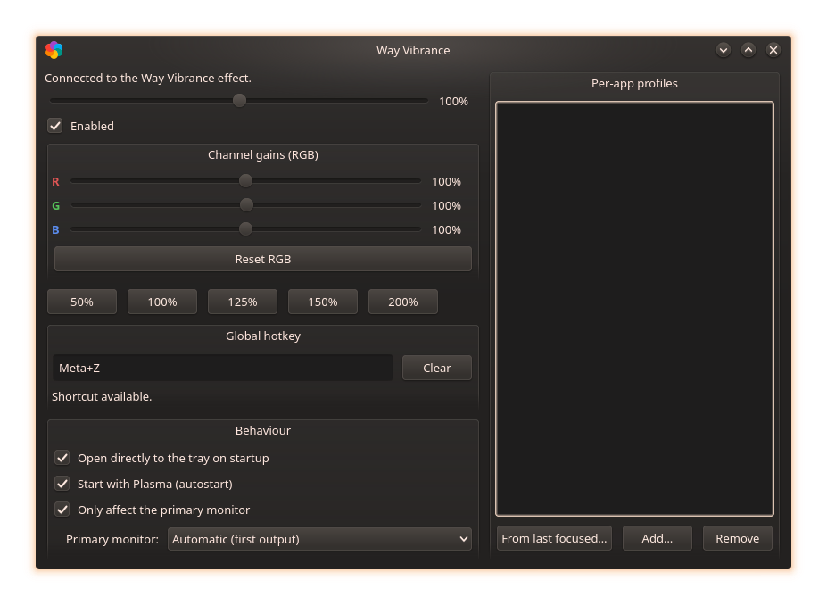
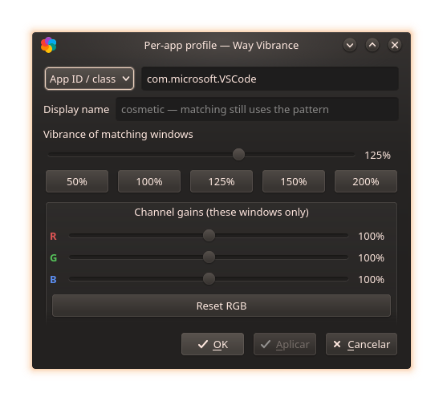
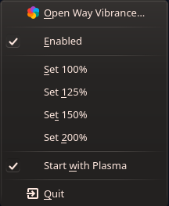

[Português](README.pt.md) | **English**

# Way Vibrance

**Digital Vibrance / saturation boost + per-channel RGB gains for Linux on
Wayland (KDE Plasma)** — the counterpart of Windows'
[vibrance-gui](https://github.com/x64christ/Vibrance-GU) /
[VibranceGUI](https://vibrancegui.com) for platforms where driver tools
(NVIDIA Digital Vibrance, AMD Saturation) simply don't exist. It works on
**any KDE Plasma 6 Wayland session**: the project uses only KWin's public,
documented effect API and is not tied to a specific Plasma version.

On Wayland no user application can write to the display's CTM (Color
Transformation Matrix): the compositor (KWin) is the sole owner of the DRM
master. The native way to get the same result is to do the color grading
**inside the compositor**, as a post-processing step — visually equivalent
to driver vibrance.

## Screenshots

Main window — global vibrance, per-channel RGB gains, presets, hotkey and
behaviour settings, with the per-app profiles pane on the right:



Per-app profile editor — pattern, cosmetic display name, vibrance presets
and dedicated channel gains:



System tray menu:



## Version compatibility

- The tray and the CLI talk **pure D-Bus** (`org.wayvibrance` plus
  `org.kde.kwin.Effects`), stable across Plasma 6 — **they depend on no
  specific KDE version**.
- The effect plugin is compiled **against the KWin installed on your
  machine** (like every third-party KWin effect: the effects API has no
  binary compatibility guarantee between releases). The same *source*
  compiles on KWin **6.0 → 6.9-git**, adapting automatically to
  `drawWindow()` signature changes (`QRegion`→`Region` in 6.6,
  `void`→`bool` in 6.8) with no version pins. After a large Plasma update,
  just rerun `scripts/build.sh`.

## How it works

- **`effect/`** — KWin 6 desktop-effect plugin (C++), with two cost-tiered
  rendering paths:
  - **Vibrance**: `WindowPaintData::multiplySaturation()` at the end of the
    effect chain (`chainPosition 99`). KWin's scene renderer applies it with
    its built-in shader, **in linear color space**, without grabbing
    windows or adding passes.
  - **Per-channel RGB gains**: when any channel differs from 100%, windows
    are additionally routed through `OffscreenEffect` with a custom GLSL
    shader multiplying the channels in linear space. With all channels at
    100% nothing is redirected and the cost is back to zero.
  - **Per-app profiles**: a rule list maps a glob (matched, case-insensitively,
    against the Wayland `app_id` / X11 `WM_CLASS`, or the window caption when
    the pattern is `title:`-prefixed) to its own vibrance value and optional
    per-channel RGB gains. Matching windows override the global settings:
    vibrance through the same built-in saturation uniform (zero extra cost,
    works even while unfocused), gains through a dedicated GLShader instance
    per distinct gain set — only windows that actually use a profile are
    redirected.
  - Values persist to `kwinrc` (`[Effect-wayvibrance]` → `Vibrance`,
    `Enabled`, `PrimaryOnly`, `RedGain`, `GreenGain`, `BlueGain`; profiles in
    the child group `[Effect-wayvibrance][WayVibranceAppRules]`).
  - Live, flicker-free control over **D-Bus**: service `org.wayvibrance`,
    object `/Vibrance`, interface `org.wayvibrance`, with methods
    `vibrance`, `setVibrance`, `enabled`, `setEnabled`, `toggleEnabled`,
    `primaryOnly`, `setPrimaryOnly`, `primaryOutputName`,
    `setPrimaryOutputName(name)`, `screenList()`,
    `redGain`/`greenGain`/`blueGain`,
    `setRGBGains(r,g,b)`, `appRules`, `setAppRule(pattern,vibrance)`,
    `setAppRuleFull(pattern,vibrance,r,g,b)`, `setAppRuleName(pattern,name)`,
    `removeAppRule(pattern)`, `clearAppRules`, `lastFocusedAppId` and signals
    `vibranceChanged`, `enabledChanged`, `rgbGainsChanged`,
    `primaryOnlyChanged`, `primaryOutputNameChanged`, `appRulesChanged`.
- **`tray/`** — `wayvibrance-tray`: Qt 6 tray app (throttled live slider,
  three RGB channel sliders with Reset, presets, enable toggle, per-app
  profile editor, configurable global hotkey, autostart, behaviour settings)
  — this is the vibrance-gui "GUI".
- **`cli/`** — `wayvibrance`: terminal control (`wayvibrance 1.25`,
  `wayvibrance toggle`, `wayvibrance get`, `wayvibrance rgb R G B`,
  `wayvibrance primary on|off|get|outputs|output <name>`,
  `wayvibrance app list|set|del|reset|focused`).

## Requirements

- **KDE Plasma 6** (KWin 6.0 or newer) on a **Wayland** session, OpenGL
  compositing. Tested on KWin 6.8 (CachyOS/Arch).
- To build (Arch/CachyOS): `scripts/build.sh` installs only what is missing
  (`cmake extra-cmake-modules kwin qt6-base qt6-tools kconfig kcoreaddons
  kdbusaddons kglobalaccel vulkan-headers libdrm wayland`, plus `base-devel`
  if no `make` is found) — it never updates your system.

## Installation

```
./scripts/build.sh
```

Then **log out and back in** so KWin loads the plugin (to hot-load into the
running session use `scripts/dev.sh load`; note KWin cannot safely reload a
changed effect binary — plugin updates need a new session). You can also
enable it under *System Settings → Desktop Effects → Appearance →
Way Vibrance*, or simply let the tray load it via D-Bus.

## Usage

- Tray/window: vibrance slider 0–200%, **three per-channel gain sliders
  (R/G/B, 0–200%) with "Reset RGB"**, presets (50/100/125/150/200%), enable
  toggle.
- **Per-app profiles** (tray group *Per-app profiles*): each profile pairs a
  glob with a vibrance value and optional R/G/B gains — `app:` patterns (the
  default) match the Wayland app_id / X11 WM_CLASS, `title:` patterns match
  the window caption (e.g. `title:*Elden Ring*`); `*` and `?` are wildcards.
  "*From last focused…*" pre-fills the app ID of the window you used last, so
  adding a game takes two clicks. The list shows friendly names
  (`org.kde.dolphin` → "Dolphin"); double-clicking a profile opens a dedicated
  window with its vibrance and channel-gain sliders plus an optional cosmetic
  **display name** for the list entry (matching always keeps using the
  pattern). **Apply** pushes changes to the screen live; **OK** closes the
  window, asking to apply anything left unapplied. On older effect builds the
  dialog automatically hides what the effect cannot do. Matching windows use
  the profile values instead of the global ones — **even in the background**,
  unlike vibrance-gui's focus-based switching.
- **Global hotkey**: unbound by default (we don't fight Plasma's own
  shortcuts). Click the *Global hotkey* field and press a combination —
  applied and persisted immediately (in `wayvibrancerc`, re-registered with
  KGlobalAccel each session), with conflict detection and a "Clear"
  button. Also editable in *System Settings → Shortcuts → Applications by
  → Way Vibrance* (changes there are mirrored back). Requires the tray
  running — enable "Start with Plasma".
- **Behaviour** (one check each, like Enabled): *Open directly to the tray
  on startup*, *Start with Plasma* (autostart, shown with the proper icon
  in Plasma's Autostart settings), *Only affect the primary monitor* (the
  grading applies only to the chosen output — a *Primary monitor* dropdown
  appears under the checkbox to pick it; "Automatic" means KWin's first
  output; windows elsewhere are composited untouched).
- CLI: `wayvibrance 1.5` · `wayvibrance toggle` · `wayvibrance get` ·
  `wayvibrance rgb 1.2 1 0.9` · `wayvibrance rgb reset` ·
  `wayvibrance primary on` · `wayvibrance app list` ·
  `wayvibrance app set firefox 1.5` · `wayvibrance app del 'title:*War*'` ·
  `wayvibrance app focused`
- Neutral state (`1.0` everywhere, no profiles) ⇒ `isActive() == false` ⇒
  the effect is out of the rendering chain: **zero cost**.

## Parity with vibrance-gui

| Feature | vibrance-gui (Windows) | Way Vibrance | status |
|---|---|---|---|
| Global vibrance boost | driver CTM | KWin shader uniform | ✅ |
| Per-channel R/G/B gains | driver Color page | offscreen GLSL pass | ✅ |
| Live adjustment | driver API | D-Bus `org.wayvibrance` | ✅ |
| Persistence | registry | `kwinrc` | ✅ |
| Tray + autostart | ✅ | ✅ | ✅ |
| Presets | profiles | 50/100/125/150/200% | ✅ |
| Toggle hotkey | ✅ | KGlobalAccel, key configurable | ✅ |
| Apply only to one monitor | — (profile-based) | "primary monitor" mode (picked output) | ✅ |
| Auto per-app/game profiles | ✅ (window focus) | per-window rules (`app:`/`title:` globs) — applies even unfocused | ✅ |
| Distinct value per monitor | ✅ | — (mode can restrict to one output since v0.5.0; independent per-output values need a per-output uniform/scene pass) | 🔜 |
| Sound/OSD on profile switch | ✅ | layer-shell OSD | 🔜 |

## Known limitations

- **The mouse cursor is not affected** (it is a separate hardware plane in
  KMS) — the same trade-off as KWin's own colorblindness-correction effect.
- **RGB gains ≠ 100% enable the offscreen path** (per-window grab +
  shader): slightly heavier than pure vibrance, which stays on the
  zero-cost native uniform. Keep the channels at 100% for the light mode.
- OpenGL compositing only (Vulkan on the roadmap).
- The plugin binary is matched to the installed KWin; a quick
  `scripts/build.sh` after major updates keeps it in step (source
  compatibility is automatic — see above).
- "Primary monitor" mode targets the output you pick (by connector name,
  e.g. `DP-1`) — KWin's effects API has no compositor-wide primary concept,
  so with no pick the **first** output is used; re-pick after changing the
  monitor setup.
- With any window effect active, exclusive-fullscreen windows may lose the
  direct-scanout fast path in the compositor (small latency cost; worth
  measuring).

## Roadmap

1. "True" vibrance (protects skin tones — [libvibrant](https://github.com/libvibrant/vibrant-cli)
   algorithm) as an optional shader mode.
2. Per-output values (the monitor picker itself is already in the tray).
3. HDR / wide-gamut correctness (BT.2020 aware grading).
4. PKGBUILD (AUR-style auto-rebuild) so every KWin update recompiles the
   effect for you.

## Status

Functional and in daily use. Current release: **v0.5.0** — the "primary
monitor" mode now targets a **user-picked output** (tray dropdown /
`wayvibrance primary output <name>`, persisted; "automatic" = first output),
replacing the old pointer-following behavior. It builds on v0.4.0: per-app/
game profiles (vibrance-gui's flagship, one step further: per-window instead
of per-focus) — `app:`/`title:` glob rules with per-profile channel gains,
cosmetic display names, a dedicated editor window with Apply/presets and
reliable live updates via in-context shader management; 50% joins the preset
row; two-pane window; CLI `wayvibrance app …`; `build.sh` installs missing
dependencies without ever updating the system. Everything from v0.3.0
(vibrance, RGB channel gains, hotkey, behaviour settings) is kept, all
capped at the real 0–200% range.

## Development

```
cmake -S . -B build -DCMAKE_BUILD_TYPE=Release -DCMAKE_INSTALL_PREFIX=/usr
cmake --build build --parallel
sudo cmake --install build
scripts/dev.sh {load|unload|toggle|status}   # hot-load into the session
```

`docs/RESEARCH.md` (Portuguese) records the KWin 6.8 API findings that
grounded every design decision — effect discovery paths, the saturation
uniform, signature mapping across releases, the D-Bus surfaces.

## AI assistance

This project was **vibe-coded with AI assistance**: code, research and
documentation were generated and refined together with an AI coding agent
(OpenCode), under the maintainer's direction and review. The full
collaboration history is preserved in the git log.

## License

GPL-2.0-or-later (compatible with KWin). See [LICENSE](LICENSE).
