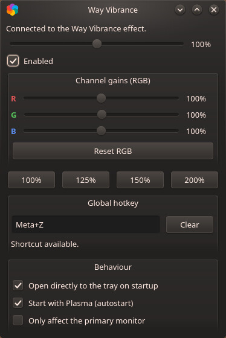
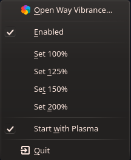

**Português** | [English](README.md)

# Way Vibrance

**Digital Vibrance / boost de saturação + ganhos RGB por canal para Linux no
Wayland (KDE Plasma)** — o equivalente ao
[vibrance-gui](https://github.com/x64christ/Vibrance-GU) /
[VibranceGUI](https://vibrancegui.com) do Windows, onde as ferramentas de
driver (NVIDIA Digital Vibrance / AMD Saturation) não existem. Funciona em
**qualquer sessão Wayland do KDE Plasma 6**: o projeto usa apenas a API
pública e documentada de efeitos do KWin, sem depender de uma versão
específica do Plasma.

No Wayland nenhum aplicativo de usuário pode escrever no CTM (Color
Transformation Matrix) do display: o compositor (KWin) é o único dono do DRM
master. A solução nativa é fazer o ajuste de cor acontecer **dentro do
compositor**, como pós-processamento — visualmente equivalente ao vibrance
do driver.

## Capturas de tela

Janela principal — slider de vibrance, ganhos RGB por canal, presets,
atalho global e configurações de comportamento:



Menu da bandeja do sistema:



## Compatibilidade de versão

- O tray e a CLI conversam **puramente via D-Bus** (`org.wayvibrance` +
  `org.kde.kwin.Effects`), estável em todo Plasma 6 — **não dependem de
  versão nenhuma do KDE**.
- O plugin do efeito é compilado **contra o KWin instalado na sua máquina**
  (regra da categoria: a API de efeitos do KWin não tem garantia binária
  entre releases). O mesmo *código-fonte* compila em KWin **6.0 → 6.9-git**,
  adaptando automaticamente as variações de assinatura do `drawWindow()`
  (`QRegion`→`Region` no 6.6, `void`→`bool` no 6.8) — sem pin de versão.
  Após um update grande do Plasma, basta rodar `scripts/build.sh` de novo.

## Como funciona

- **`effect/`** — plugin C++ de desktop effect do KWin 6, com dois caminhos
  de renderização separados por custo:
  - **Vibrância**: `WindowPaintData::multiplySaturation()` no fim da cadeia
    de efeitos (`chainPosition 99`). O renderizador de cena do KWin aplica
    com o shader embutido, em **espaço de cor linear**, sem grab de janelas
    nem passe extra.
  - **Ganhos RGB por canal**: quando qualquer canal ≠ 100%, as janelas
    passam pelo caminho *offscreen* (`OffscreenEffect`) com shader GLSL
    próprio que multiplica os canais em espaço linear. Com todos os canais
    em 100%, nada é redirecionado e o custo volta a zero.
  - **Perfis por aplicação/jogo**: uma lista de regras associa um glob
    (comparado sem diferenciar maiúsculas contra o `app_id` do Wayland /
    `WM_CLASS` do X11, ou contra o título da janela quando o padrão usa o
    prefixo `title:`) a um valor de vibrância. Janelas que casam substituem o
    valor global usando o mesmo uniform de saturação embutido — por janela,
    mesmo sem foco, com custo de GPU zero.
  - Valores persistem em `kwinrc` (`[Effect-wayvibrance]` → `Vibrance`,
    `Enabled`, `PrimaryOnly`, `RedGain`, `GreenGain`, `BlueGain`; os perfis
    ficam no subgrupo `[Effect-wayvibrance][WayVibranceAppRules]`).
  - Controle ao vivo (sem flicker/`reconfigure`) via **D-Bus**: serviço
    `org.wayvibrance`, objeto `/Vibrance`, interface `org.wayvibrance`,
    métodos `vibrance`, `setVibrance`, `enabled`, `setEnabled`,
    `toggleEnabled`, `primaryOnly`, `setPrimaryOnly`,
    `redGain`/`greenGain`/`blueGain`, `setRGBGains(r,g,b)`, `appRules`,
    `setAppRule(padrão,vibrância)`, `removeAppRule(padrão)`,
    `clearAppRules`, `lastFocusedAppId` e sinais `vibranceChanged`,
    `enabledChanged`, `rgbGainsChanged`, `primaryOnlyChanged`,
    `appRulesChanged`.
- **`tray/`** — `wayvibrance-tray`: app de bandeja em Qt 6 (slider ao vivo
  com throttle, 3 sliders de canal RGB com Reset, presets, liga/desliga,
  editor de perfis por aplicação, hotkey global configurável, autostart,
  configurações de comportamento) — é o "GUI" do vibrance-gui.
- **`cli/`** — `wayvibrance`: terminal (`wayvibrance 1.25`,
  `wayvibrance toggle`, `wayvibrance get`, `wayvibrance rgb R G B`,
  `wayvibrance primary on|off|get`, `wayvibrance app list|set|del|reset|focused`).

## Requisitos

- **KDE Plasma 6** (KWin 6.0 ou mais novo) em sessão **Wayland**, composição
  OpenGL. Testado em KWin 6.8 (CachyOS/Arch).
- Para compilar (Arch/CachyOS): `scripts/build.sh` instala tudo
  (`base-devel cmake extra-cmake-modules kwin qt6-base kconfig kcoreaddons
  kdbusaddons kglobalaccel vulkan-headers`).

## Instalação

```
./scripts/build.sh
```

Depois faça **logout + login** para o KWin carregar o plugin (para hot-load
na sessão atual use `scripts/dev.sh load`; note que o KWin não recarrega
com segurança um binário de efeito alterado — mudanças no plugin exigem nova
sessão). Também dá para ativar em *Configurações do Sistema → Efeitos da
Área de Trabalho → Aparência → Way Vibrance*, ou deixar o tray carregá-lo
via D-Bus.

## Uso

- Bandeja/janela: slider de vibrância 0–200%, **3 sliders de ganho por canal
  (R/G/B, 0–200%) com "Reset RGB"**, presets (100/125/150/200%),
  liga/desliga.
- **Perfis por aplicação/jogo** (grupo *Per-app profiles* na janela): cada
  perfil combina um glob com um valor de vibrância — padrões `app:` (o
  padrão) casam com o app_id do Wayland / WM_CLASS do X11, padrões `title:`
  casam com o título da janela (ex.: `title:*Elden Ring*`); `*` e `?` são
  curingas. O botão *"De último foco…"* pré-preenche o app_id da janela usada
  por último — dois cliques para cadastrar um jogo. Janelas casadas usam o
  valor do perfil em vez do global, **mesmo em segundo plano** (diferente do
  vibrance-gui, que troca só no foco), sem custo extra de GPU.
- **Hotkey global**: sem vínculo padrão (não brigamos com os atalhos do
  Plasma). Clique no campo *Global hotkey* e digite a combinação — aplicada
  e persistida na hora (em `wayvibrancerc`, re-registrada no KGlobalAccel a
  cada sessão), com detector de conflito e botão "Clear". Também editável em
  *Configurações do Sistema → Atalhos de Teclado → wayvibrance-tray* (o tray
  absorve mudanças feitas lá). Requer o tray rodando — ative "Start with
  Plasma".
- **Comportamento** (um check cada, como o Enabled): *Abrir direto na
  bandeja ao iniciar*, *Iniciar com o Plasma* (autostart, exibido com ícone
  correto no KCM de Autostart), *Afetar apenas o monitor primário* (a
  correção vale só para a tela ativa; janelas fora são compostas intocadas).
- CLI: `wayvibrance 1.5` · `wayvibrance toggle` · `wayvibrance get` ·
  `wayvibrance rgb 1.2 1 0.9` · `wayvibrance rgb reset` ·
  `wayvibrance primary on` · `wayvibrance app list` ·
  `wayvibrance app set firefox 1.5` · `wayvibrance app del 'title:*War*'` ·
  `wayvibrance app focused`
- Estado neutro (`1.0` em tudo, sem perfis) ⇒ `isActive() == false` ⇒ o
  efeito sai da cadeia de renderização: **custo zero**.

## Paridade com o vibrance-gui

| Recurso | vibrance-gui (Windows) | Way Vibrance | status |
|---|---|---|---|
| Boost de vibrância global | driver CTM | uniform do shader no KWin | ✅ |
| Ganhos por canal R/G/B | aba Color do driver | passe offscreen com GLSL | ✅ |
| Ajuste ao vivo | driver API | D-Bus `org.wayvibrance` | ✅ |
| Persistência | registro | `kwinrc` | ✅ |
| Bandeja + autostart | ✅ | ✅ | ✅ |
| Presets | perfis | 100/125/150/200% | ✅ |
| Hotkey para alternar | ✅ | KGlobalAccel, tecla configurável | ✅ |
| Afetar só um monitor | — (via perfis) | modo "monitor primário" (tela ativa) | ✅ |
| Perfis automáticos por app/jogo | ✅ (foco de janela) | regras por janela (`app:`/`title:` glob) — vale até sem foco | ✅ |
| Valor próprio por monitor | ✅ | valores por saída | 🔜 |
| Som/OSD ao trocar perfil | ✅ | OSD layer-shell | 🔜 |

## Limitações conhecidas

- **O cursor do mouse não é afetado** (é um hardware plane separado no KMS) —
  mesmo trade-off do efeito de correção de daltonismo do próprio KWin.
- **Ganhos RGB ≠ 100% ativam o caminho offscreen** (grab por janela +
  shader): um pouco mais pesado que a vibrância pura, que segue no caminho
  de custo zero. Deixe os canais em 100% para o modo leve.
- Composição OpenGL apenas (Vulkan no roadmap).
- O binário do plugin é casado com o KWin instalado; um `scripts/build.sh`
  rápido após updates grandes mantém tudo em dia (a compatibilidade de
  fonte é automática — ver acima).
- "Monitor primário" usa o `activeScreen()` do KWin (a tela sob o cursor)
  como proxy: a API pública de efeitos não expõe o conceito de saída
  primária. Seletor por monitor está no roadmap.
- Com efeito de janela ativo, janelas em fullscreen exclusivo podem perder o
  fast path de direct scanout do compositor (leve custo de latência; medir).

## Roadmap

1. Vibrância "de verdade" (protege tons de pele — algoritmo do
   [libvibrant](https://github.com/libvibrant/vibrant-cli)) como modo
   opcional de shader.
2. Valores por saída com seletor de monitor (substitui o proxy de tela ativa).
3. HDR / fidelidade em wide gamut (correção consciente de BT.2020).
4. PKGBUILD (rebuild automático estilo AUR) para recompilar o efeito a cada
   update do KWin.

## Estado

Funcional e em uso diário. Release atual: **v0.3.0** — vibrância, ganhos por
canal RGB, hotkey configurável, configurações de comportamento (abrir na
bandeja, autostart, modo monitor primário), todos os sliders no teto real de
0–200%. Perfis por aplicação/jogo (o carro-chefe do vibrance-gui, um passo à
frente: por janela em vez de por foco) já implementados no `main`, aguardando
release.

## Desenvolvimento

```
cmake -S . -B build -DCMAKE_BUILD_TYPE=Release -DCMAKE_INSTALL_PREFIX=/usr
cmake --build build --parallel
sudo cmake --install build
scripts/dev.sh {load|unload|toggle|status}   # hot-load na sessão
```

`docs/RESEARCH.md` registra as descobertas da API do KWin 6.8 que
fundamentaram cada decisão — caminhos de descoberta de efeitos, o uniform de
saturação, o mapa de assinaturas entre releases e as superfícies D-Bus.

## Assistência de IA

Este projeto foi criado **vibe-coded com auxílio de IA**: código, pesquisa e
documentação foram gerados e refinados junto com um agente de programação
por IA (OpenCode), sob direção e revisão do mantenedor. Todo o histórico da
colaboração está preservado no git log.

## Licença

GPL-2.0-or-later (compatível com o KWin). Veja [LICENSE](LICENSE).
