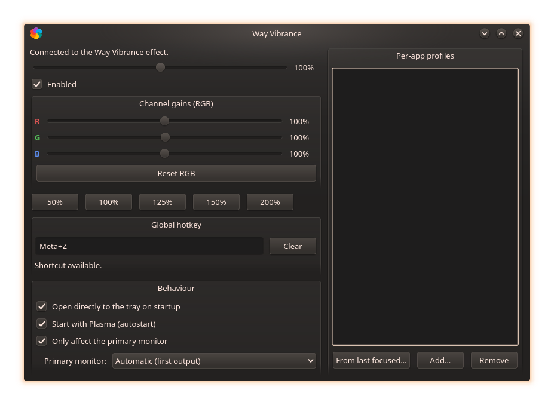
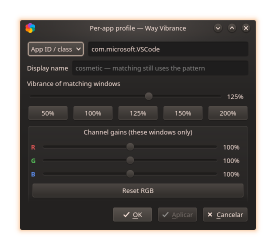
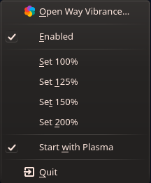

# Way Vibrance — Features & Reference

The full guide; the [README](../README.md) keeps only what you need to build
and run. Back to [README](../README.md) · [Roadmap](ROADMAP.md).

## Table of contents
- [How it works](#how-it-works)
- [Per-app profiles (the deep dive)](#per-app-profiles)
- [Hotkey & behaviour settings](#hotkey--behaviour-settings)
- [CLI reference](#cli-reference)
- [D-Bus API](#d-bus-api)
- [Configuration files](#configuration-files)
- [Version compatibility](#version-compatibility)
- [Parity with vibrance-gui](#parity-with-vibrance-gui)
- [Known limitations](#known-limitations)
- [Privacy & footprint](#privacy--footprint)
- [Screenshots](#screenshots)

## How it works

- **`effect/`** — KWin 6 desktop-effect plugin (C++), with cost-tiered
  rendering paths:
  - **Vibrance**: `WindowPaintData::multiplySaturation()` at the end of the
    effect chain (`chainPosition 99`). KWin's scene renderer applies it with
    its built-in shader, **in linear color space**, without grabbing windows
    or adding passes.
  - **Per-channel RGB gains**: when any channel differs from 100%, windows
    are additionally routed through `OffscreenEffect` with a custom GLSL
    shader multiplying the channels in linear space. With all channels at
    100% nothing is redirected and the cost is back to zero.
  - **All GL work happens inside `drawWindow`** (the only place the GL
    context is guaranteed current): shader instances are created and
    `rgbGain` uniforms uploaded there — events from D-Bus/config only mark
    state dirty and request a repaint. Each distinct gain set gets its own
    `GLShader` instance; only windows that actually use gains are redirected.
- **`tray/`** — `wayvibrance-tray`: Qt 6 tray app (throttled live sliders,
  presets, per-app profile editor, global hotkey, autostart, behaviour
  settings, monitor picker).
- **`cli/`** — `wayvibrance`: terminal control over the same D-Bus interface
  (`wayvibrance --help` for everything).
- Neutral state (`1.0` everywhere, no profiles) ⇒ `isActive() == false` ⇒
  the effect is out of the rendering chain: **zero cost**.

## Per-app profiles

The counterpart of vibrance-gui's per-game profiles — and one step further:
they apply **per window**, not per focus, so a background stream or a second
monitor's game keeps its look.

- **Pattern** (case-insensitive glob; `*` and `?` wildcards):
  - `app:` (default) matches the **Wayland app_id** / **X11 WM_CLASS** —
    e.g. `firefox`, `org.kde.dolphin`, `*steam*`.
  - `title:` matches the **window caption** — e.g. `title:*Elden Ring*`
    (handy when the app_id is generic, like Proton launchers).
- **Values**: vibrance (0–200%) and optional per-channel R/G/B gains
  (0–200%) — matching windows override the global values.
- **Display name**: purely cosmetic label in the list (`org.kde.dolphin`
  shown as "Dolphin" automatically; your own string overrides). Matching
  always uses the pattern.
- **Tray**: list with friendly names and `[+RGB …]` badge; *From last
  focused…* pre-fills the app id of the last-used window (two clicks to
  enroll a game); double-click opens the editor window (sliders + presets
  50/100/125/150/200% + Reset RGB); **Apply** commits live, **OK** closes
  (confirming if something is unapplied; a never-applied new profile is
  saved silently on OK); the dialog hides features the running effect build
  cannot do.
- **Persistence**: `[Effect-wayvibrance][WayVibranceAppRules]` in `kwinrc`.

## Hotkey & behaviour settings

- **Global hotkey**: unbound by default (we don't fight Plasma's shortcuts).
  Click the *Global hotkey* field and press a combination — applied and
  persisted immediately (in `wayvibrancerc`, re-registered with KGlobalAccel
  each session), with conflict detection and a "Clear" button. Also editable
  in *System Settings → Shortcuts → Applications → Way Vibrance* (changes
  there are mirrored back). Requires the tray running — enable "Start with
  Plasma".
- **Behaviour** (one check each): *Open directly to the tray on startup*,
  *Start with Plasma* (autostart, shown with the proper icon in Plasma's
  Autostart settings), *Only affect the primary monitor* — grading applies
  only to the **chosen output**: a *Primary monitor* dropdown appears under
  the checkbox (picks by connector name, e.g. `DP-1`; "Automatic" = KWin's
  first output; the picked output's list refreshes on hotplug).

## CLI reference

Full and authoritative output: `wayvibrance --help`. Quick map:

```
wayvibrance                     # current vibrance
wayvibrance 1.25                # set vibrance (also: on/off/toggle/load)
wayvibrance rgb 1.2 1 0.9       # channel gains (rgb reset, getrgb)
wayvibrance primary on|off|get|outputs|output <name>|output-get
wayvibrance app list|set|del|name|reset|focused
```

## D-Bus API

Service `org.wayvibrance`, object `/Vibrance`, interface `org.wayvibrance`.

| Methods | Signals |
|---|---|
| `vibrance` / `setVibrance(v)` | `vibranceChanged(v)` |
| `enabled` / `setEnabled(b)` / `toggleEnabled` | `enabledChanged(b)` |
| `redGain`/`greenGain`/`blueGain` / `setRGBGains(r,g,b)` | `rgbGainsChanged(r,g,b)` |
| `primaryOnly` / `setPrimaryOnly(b)` | `primaryOnlyChanged(b)` |
| `primaryOutputName` / `setPrimaryOutputName(name)` / `screenList()` | `primaryOutputNameChanged(name)` |
| `appRules` / `setAppRule(pat,v)` / `setAppRuleFull(pat,v,r,g,b)` / `setAppRuleName(pat,name)` / `removeAppRule(pat)` / `clearAppRules` / `lastFocusedAppId()` | `appRulesChanged(rules)` |

Profile serialization: `kind:pattern|vibrance[|r,g,b[|display-name]]`
(`kind` ∈ `app`,`title`; patterns and names never contain `|`).

## Configuration files

| File | Contents |
|---|---|
| `~/.config/kwinrc` | `[Effect-wayvibrance]`: `Vibrance`, `Enabled`, `PrimaryOnly`, `PrimaryOutput`, `RedGain/GainGreenGain/BlueGain`; child group `[WayVibranceAppRules]` with one percent-encoded entry per profile |
| `~/.config/wayvibrancerc` | hotkey (`[Shortcuts] GlobalToggleShortcut`) and `[General] StartHidden` |
| `~/.config/autostart/org.kde.wayvibrance-tray.desktop` | autostart toggle |

## Version compatibility

- The tray and the CLI talk **pure D-Bus** (`org.wayvibrance` plus
  `org.kde.kwin.Effects`), stable across Plasma 6 — they depend on no
  specific KDE version.
- The effect plugin is compiled **against the KWin installed on your
  machine** (like every third-party KWin effect: the effects API has no
  binary compatibility guarantee between releases). The same *source*
  compiles on KWin **6.0 → 6.9+**, adapting to `drawWindow()` signature
  changes (`QRegion`→`Region` in 6.6, `void`→`bool` in 6.8) via `decltype`
  on the base signature, and to the output-class reshuffle (Screen/Output/
  LogicalOutput) via `auto`-deduced iteration + `__has_include` — no
  version pins. After a large Plasma update, rerun `scripts/build.sh`.
- Verified container builds: Arch, Fedora, Debian 13 (KWin 6.3.4), Ubuntu
  25.04 (KWin 6.3.4), plus the daily driver at KWin 6.8.2.

## Parity with vibrance-gui

| Feature | vibrance-gui (Windows) | Way Vibrance | status |
|---|---|---|---|
| Global vibrance boost | driver CTM | KWin shader uniform | ✅ |
| Per-channel R/G/B gains | driver Color page | offscreen GLSL pass | ✅ |
| Live adjustment | driver API | D-Bus `org.wayvibrance` | ✅ |
| Persistence | registry | `kwinrc` | ✅ |
| Tray + autostart | ✅ | ✅ | ✅ |
| Presets | profiles | 50/100/125/150/200% | ✅ |
| Toggle hotkey | ✅ | KGlobalAccel, key configurable | ✅ |
| Apply only to one monitor | — (profile-based) | "primary monitor" mode (picked output) | ✅ |
| Auto per-app/game profiles | ✅ (window focus) | per-window rules (`app:`/`title:` globs) — applies even unfocused | ✅ |
| Distinct value per monitor | ✅ | — (restriction exists since v0.5.0; independent values per output need a per-output uniform/scene pass) | 🔜 |
| Sound/OSD on profile switch | ✅ | layer-shell OSD | 🔜 |

## Known limitations

- **The mouse cursor is not affected** (it is a separate hardware plane in
  KMS) — the same trade-off as KWin's own colorblindness-correction effect.
- **RGB gains ≠ 100% enable the offscreen path** (per-window grab + shader):
  slightly heavier than pure vibrance, which stays on the zero-cost native
  uniform. Keep the channels at 100% for the light mode.
- **OpenGL compositing only** (Vulkan on the roadmap; under Vulkan the
  effect deliberately does not load rather than silently no-op).
- The plugin binary is matched to the installed KWin; a quick
  `scripts/build.sh` (or the matching prebuilt package) after major updates
  keeps it in step.
- "Primary monitor" mode targets the output you pick by connector name —
  with no pick, the **first** output is used; re-pick after changing the
  monitor setup.
- With any window effect active, exclusive-fullscreen windows may lose the
  direct-scanout fast path in the compositor (small latency cost; worth
  measuring).
- Immutable distros (Silverblue/Kinoite/SteamOS): KWin only loads effects
  from system plugin directories — user-scope paths were tested and do not
  work (6.3–6.8). Use the prebuilt RPM with `rpm-ostree install`. On
  SteamOS specifically, the gamescope gaming session runs no KWin, so the
  effect applies only to the desktop session.

## Privacy & footprint

Everything runs in **userspace**:
- no daemons, no kernel modules, no network access, no telemetry;
- D-Bus on the **session bus only** (`org.wayvibrance` service + the tray's
  own component name); no system bus usage;
- writes only to `~/.config/kwinrc` (effect state, managed by KWin itself),
  `~/.config/wayvibrancerc` (hotkey/behaviour) and the optional autostart
  `.desktop`;
- `scripts/build.sh` installs only missing packages and **never updates
  the system**; inside containers it refuses to write to `/usr` by default;
- system-wide installation (`sudo cmake --install`) is only the file copy
  step — the software never needs root at runtime.

## Screenshots

| Main window | Profile editor | Tray menu |
|---|---|---|
|  |  |  |
