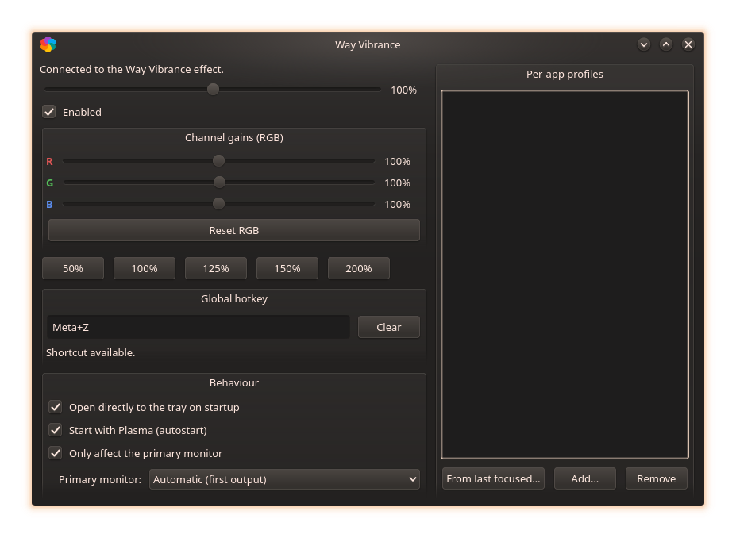
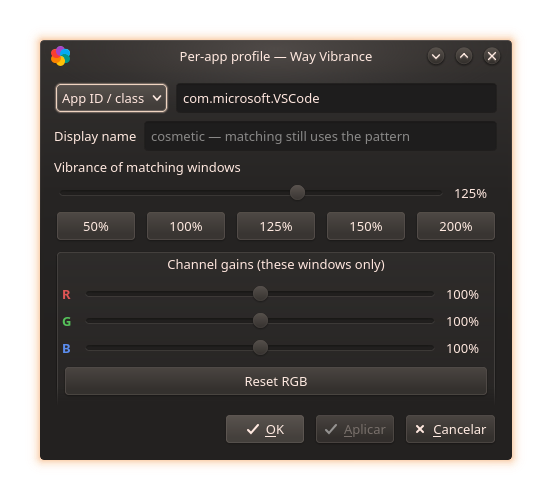
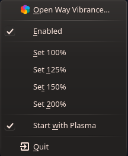

[English](FEATURES.md) | [Português](FEATURES.pt.md)

# Way Vibrance — Recursos & Referência

O guia completo; o [README](../README.pt.md) mantém só o essencial para
compilar e usar. Voltar ao [README](../README.pt.md) ·
[Roadmap](ROADMAP.pt.md).

## Índice
- [Como funciona](#como-funciona)
- [Perfis por aplicação (detalhes)](#perfis-por-aplicação)
- [Hotkey & configurações de comportamento](#hotkey--configurações-de-comportamento)
- [Referência da CLI](#referência-da-cli)
- [API D-Bus](#api-d-bus)
- [Arquivos de configuração](#arquivos-de-configuração)
- [Compatibilidade de versão](#compatibilidade-de-versão)
- [Paridade com vibrance-gui](#paridade-com-vibrance-gui)
- [Limitações conhecidas](#limitações-conhecidas)
- [Privacidade & pegada](#privacidade--pegada)
- [Segurança frente a anticheats](#segurança-frente-a-anticheats)
- [Capturas de tela](#capturas-de-tela)

## Como funciona

- **`effect/`** — plugin de efeito de desktop KWin 6 (C++), com caminhos de
  renderização separados por custo:
  - **Vibrância**: `WindowPaintData::multiplySaturation()` no fim da cadeia
    de efeitos (`chainPosition 99`). O renderizador de cena do KWin aplica
    com o shader embutido, em **espaço de cor linear**, sem grab de janelas
    nem passe extra.
  - **Ganhos RGB por canal**: quando qualquer canal ≠ 100%, as janelas
    passam pelo caminho *offscreen* (`OffscreenEffect`) com shader GLSL
    próprio que multiplica os canais em espaço linear. Com todos os canais
    em 100%, nada é redirecionado e o custo volta a zero.
  - **Todo trabalho GL acontece dentro de `drawWindow`** (único ponto com
    contexto GL garantido corrente): instâncias de shader são criadas e
    uniforms `rgbGain` enviados ali — eventos de D-Bus/config apenas marcam
    estado como pendente e pedem repaint. Cada conjunto distinto de ganhos
    ganha sua instância de `GLShader`; só janelas que realmente usam ganhos
    são redirecionadas.
- **`tray/`** — `wayvibrance-tray`: app de bandeja Qt 6 (sliders ao vivo com
  throttle, presets, editor de perfis por app, hotkey global, autostart,
  comportamento, seletor de monitor).
- **`cli/`** — `wayvibrance`: controle pelo mesmo D-Bus
  (`wayvibrance --help` para tudo).
- Estado neutro (`1.0` em tudo, sem perfis) ⇒ `isActive() == false` ⇒ o
  efeito sai da cadeia de renderização: **custo zero**.

## Perfis por aplicação

O equivalente dos perfis por jogo do vibrance-gui — e um passo à frente:
aplicam **por janela**, não por foco, então uma stream de fundo ou o jogo
no segundo monitor mantêm o visual.

- **Padrão** (glob sem diferenciação de maiúsculas; curingas `*` e `?`):
  - `app:` (padrão) casa o **app_id do Wayland** / **WM_CLASS do X11** —
    ex.: `firefox`, `org.kde.dolphin`, `*steam*`.
  - `title:` casa o **título da janela** — ex.: `title:*Elden Ring*` (útil
    quando o app_id é genérico, como launchers Proton).
- **Valores**: vibrância (0–200%) e ganhos R/G/B por canal opcionais
  (0–200%) — janelas casadas substituem os valores globais.
- **Nome de exibição**: rótulo cosmético na lista (`org.kde.dolphin` vira
  "Dolphin" automaticamente; sua string sobrescreve). O casamento usa
  sempre o padrão.
- **Bandeja**: as consultas de estado são assíncronas com timeout limitado — um
  compositor ocupado ou travado não consegue congelar a UI; lista com nomes
  amigáveis e selo `[+RGB …]`; *"De último
  foco…"* pré-preenche o app_id da última janela usada — dois cliques para
  cadastrar um jogo; duplo clique abre a janela de edição (sliders + presets
  50/100/125/150/200% + Reset RGB); cada porcentagem tem um pequeno botão
  circular **↺** que restaura só aquele slider ao padrão (100%) — vibrância
  global, cada canal RGB e cada slider do editor de perfis; **Apply** comita
  ao vivo, **OK** fecha
  (confirmando pendências; perfil novo nunca aplicado é salvo em silêncio);
  o diálogo esconde o que o build do efeito em execução não suporta.
- **Persistência**: `[Effect-wayvibrance][WayVibranceAppRules]` no `kwinrc`.
- **Limites** (contenção de DoS local): no máximo 64 perfis, padrão com até
  128 caracteres, nome de exibição com até 64; efeito, diálogo do tray e
  carregamento de configuração aplicam os mesmos tetos, rejeitando valores
  não finitos em vez de deixá-los chegar ao compositor. Strings acima do
  teto são recusadas antes de qualquer processamento (padrões prefixados
  brutos ≤ 140 caracteres, nomes de saída ≤ 256) — nenhum caminho de
  trim/comparação/persistência chega a ver entrada de megabytes. As
  identidades vindas das janelas (título, WM_CLASS, app_id) também são
  limitadas a 1024 caracteres antes de qualquer comparação no caminho de
  pintura, e uma identidade acima do teto fica simplesmente fora do match
  de perfis — um cliente despejando nomes de janela de megabytes não
  consegue cobrar isso do compositor. Os padrões são
  comparados por um matcher de glob dedicado de custo limitado: no pior caso
  padrão × texto (≤ 128 × 1024 caracteres) sob um orçamento explícito de
  passos acima desse produto — sem engine de regex, portanto sem explosão de
  backtracking —, com comportamento verificado por fuzz como idêntico à
  tradução para regex anterior.
  As combinações de ganho por perfil têm cache de shaders limitado a 72
  variantes compiladas — teto deliberadamente acima do maior conjunto de
  trabalho legítimo (64 perfis + o global): o pool guarda estilos vivos e
  sobras de edição, recicladas assim que ele enche; editar ganhos sem fim
  não faz a memória da GPU nem o trabalho do compilador crescerem.
  Substituir por uma variante cacheada só é permitido até 2% por canal, e
  conjuntos mais distantes são recusados explicitamente (a janela mantém a
  vibrância do perfil e apenas dispensa o passe extra) — ramo de defesa em
  profundidade, já que o teto de perfis torna 72 variantes concorrentes
  inalcançáveis pela API.

## Hotkey & configurações de comportamento

- **Hotkey global**: sem vínculo padrão (não brigamos com os atalhos do
  Plasma). Clique no campo *Global hotkey* e digite a combinação — aplicada e
  persistida na hora (em `wayvibrancerc`, re-registrada no KGlobalAccel a
  cada sessão), com detector de conflito e botão "Clear". Também editável em
  *Configurações do Sistema → Atalhos de Teclado → Applications → Way
  Vibrance* (mudanças feitas lá são absorvidas). Requer o tray rodando —
  ative "Start with Plasma".
- **Comportamento** (um check cada): *Abrir direto na bandeja ao iniciar*,
  *Iniciar com o Plasma* (autostart, exibido com ícone correto no KCM de
  Autostart), *Afetar apenas o monitor primário* — a correção vale só para a
  **saída escolhida**: um dropdown *Primary monitor* aparece sob o check
  (seleciona por nome de conector, ex.: `DP-1`; "Automatic" = primeira saída
  do KWin; a lista atualiza em hotplug).

## Referência da CLI

Saída completa e autoritativa: `wayvibrance --help`. Mapa rápido:

```
wayvibrance                     # vibrância atual
wayvibrance 1.25                # define (também: on/off/toggle/load)
wayvibrance rgb 1.2 1 0.9       # ganhos de canal (rgb reset, getrgb)
wayvibrance primary on|off|get|outputs|output <nome>|output-get
wayvibrance app list|set|del|name|reset|focused
```

## API D-Bus

Serviço `org.wayvibrance`, objeto `/Vibrance`, interface `org.wayvibrance`.

| Métodos | Sinais |
|---|---|
| `vibrance` / `setVibrance(v)` | `vibranceChanged(v)` |
| `enabled` / `setEnabled(b)` / `toggleEnabled` | `enabledChanged(b)` |
| `redGain`/`greenGain`/`blueGain` / `setRGBGains(r,g,b)` | `rgbGainsChanged(r,g,b)` |
| `primaryOnly` / `setPrimaryOnly(b)` | `primaryOnlyChanged(b)` |
| `primaryOutputName` / `setPrimaryOutputName(nome)` / `screenList()` | `primaryOutputNameChanged(nome)` |
| `appRules` / `setAppRule(pat,v)` / `setAppRuleFull(pat,v,r,g,b)` / `setAppRuleName(pat,nome)` / `removeAppRule(pat)` / `clearAppRules` / `lastFocusedAppId()` | `appRulesChanged(rules)` |

Serialização de perfis: `kind:padrão|vibrância[|r,g,b[|nome]]`
(`kind` ∈ `app`,`title`; padrões e nomes nunca contêm `|`).

## Arquivos de configuração

| Arquivo | Conteúdo |
|---|---|
| `~/.config/kwinrc` | `[Effect-wayvibrance]`: `Vibrance`, `Enabled`, `PrimaryOnly`, `PrimaryOutput`, `RedGain/GreenGain/BlueGain`; subgrupo `[WayVibranceAppRules]` com uma entrada percent-encoded por perfil |
| `~/.config/wayvibrancerc` | hotkey (`[Shortcuts] GlobalToggleShortcut`) e `[General] StartHidden` |
| `~/.config/autostart/org.kde.wayvibrance-tray.desktop` | toggle de autostart |

`scripts/uninstall.sh [--prefix PATH] [--purge-config] [--dry-run]` remove
um build instalado manualmente, fazendo o hot-unload do efeito antes; cada
candidato a remoção (incluindo o manifesto do build) é canonicalizado —
resolvendo symlinks — e validado contra o prefixo real e uma allowlist de
arquivos antes de qualquer exclusão: nem um manifesto adulterado nem um
`bin ->` plantado conseguem contrabandear caminhos alheios para o `sudo rm`.
Instalações via pacote se desfazem pelo gerenciador de pacotes.

## Compatibilidade de versão

- Tray e CLI falam **D-Bus puro** (`org.wayvibrance` +
  `org.kde.kwin.Effects`), estável em todo Plasma 6 — não dependem de
  nenhuma versão específica do KDE.
- O plugin do efeito é compilado **contra o KWin instalado na máquina**
  (como todo efeito de terceiros: a API de efeitos não tem garantia de
  compatibilidade binária entre releases). O mesmo *fonte* compila em KWin
  **6.0 → 6.9+**, absorvendo as mudanças de assinatura de `drawWindow()`
  (`QRegion`→`Region` no 6.6, `void`→`bool` no 6.8) via `decltype` na
  assinatura da base, e o reordenamento das classes de output
  (Screen/Output/LogicalOutput) via iteração `auto` + `__has_include` — sem
  pin de versão. Após um update grande do Plasma, rode
  `scripts/build.sh`.
- Builds em contêiner verificados: Arch, Fedora 44/45, Debian 13/14 (testing)
  e Ubuntu 26.04/26.10 — cada artefato é adicionalmente *instalado e verificado*
  num contêiner limpo da própria release — além do uso diário em KWin 6.8.2.
- **Política de prebuilts**: um binário por release de distro, cada um
  compilado num contêiner descartável daquela release
  (`scripts/package.sh`) — misturar plugin compilado contra um KWin minor
  com outro pode quebrar no load (sem promessa de ABI). Os nomes embutem o
  alvo: `.fc44/.fc45`, `~debian13/~debian14`, `~ubuntu26.04…`.
  Releases em EOL upstream saem da matriz (Ubuntu 25.04/25.10 foram
  removidos quando a Canonical encerrou o suporte).

## Paridade com vibrance-gui

| Recurso | vibrance-gui (Windows) | Way Vibrance | status |
|---|---|---|---|
| Boost de vibrância global | driver CTM | uniform do shader no KWin | ✅ |
| Ganhos por canal R/G/B | aba Color do driver | passe offscreen com GLSL | ✅ |
| Ajuste ao vivo | driver API | D-Bus `org.wayvibrance` | ✅ |
| Persistência | registro | `kwinrc` | ✅ |
| Bandeja + autostart | ✅ | ✅ | ✅ |
| Presets | perfis | 50/100/125/150/200% | ✅ |
| Hotkey para alternar | ✅ | KGlobalAccel, tecla configurável | ✅ |
| Afetar só um monitor | — (via perfis) | modo "monitor primário" (saída escolhida) | ✅ |
| Perfis automáticos por app/jogo | ✅ (foco de janela) | regras por janela (`app:`/`title:` glob) — vale até sem foco | ✅ |
| Valor próprio por monitor | ✅ | — (restrição existe desde a v0.5.0; valores independentes por saída pedem uniform/passe por saída) | 🔜 |
| Som/OSD ao trocar perfil | ✅ | OSD layer-shell | 🔜 |

## Limitações conhecidas

- **O cursor do mouse não é afetado** (hardware plane separado no KMS) —
  mesmo trade-off do efeito de correção de daltonismo do próprio KWin.
- **Ganhos RGB ≠ 100% ativam o caminho offscreen** (grab por janela +
  shader): um pouco mais pesado que a vibrância pura, que segue no caminho
  de custo zero. Deixe os canais em 100% para o modo leve.
- **Composição OpenGL apenas** (Vulkan no roadmap; sob Vulkan o efeito
  deliberadamente não carrega, em vez de virar no-op silencioso).
- O binário do plugin é casado com o KWin instalado; um
  `scripts/build.sh` rápido (ou o pacote prebuilt correspondente) após
  updates grandes mantém tudo em dia.
- "Monitor primário" mira a saída escolhida por nome de conector — sem
  escolha, usa-se a **primeira** saída; reselecione após mudar a configuração
  de monitores.
- Com efeito de janela ativo, janelas em fullscreen exclusivo podem perder o
  fast path de direct scanout do compositor (leve custo de latência; medir).
- Distros imutáveis (Silverblue/Kinoite/SteamOS): o KWin só carrega efeitos
  de diretórios de sistema — escopo de usuário foi testado e **não**
  funciona (6.3–6.8). Use o RPM prebuilt com `rpm-ostree install`. No
  SteamOS, a sessão de jogos gamescope não roda KWin: o efeito vale apenas
  para a sessão desktop.

## Privacidade & pegada

Tudo roda em **espaço de usuário**:
- sem daemons, sem módulos de kernel, sem rede, sem telemetria;
- D-Bus apenas no **bus de sessão** (serviço `org.wayvibrance` + o nome de
  componente do tray); nada de bus de sistema;
- o tray só confia em `org.wayvibrance` quando a conexão dona do nome **é o
  próprio processo do compositor** — o PID é cruzado com `org.kde.KWin` no
  attach e revalidado a cada troca de dono; estados vindos de sinais e de
  method replies passam pela mesma validação de finitude/intervalo/tamanho
  — um processo que roube o nome primeiro (ou troque de dono depois) não
  consegue falsificar a UI nem alimentar valores hostis;
- escreve só em `~/.config/kwinrc` (estado do efeito, gerido pelo próprio
  KWin), `~/.config/wayvibrancerc` (hotkey/comportamento) e o `.desktop` de
  autostart opcional;
- `scripts/build.sh` instala apenas pacotes ausentes e **nunca atualiza o
  sistema**; dentro de contêineres recusa escrever em `/usr` por padrão;
- a instalação em `/usr` (`sudo cmake --install`) é só a cópia de arquivos —
  o software nunca precisa de root em tempo de execução.

## Segurança frente a anticheats

**Usar o Way Vibrance pode levar a ban em jogos online?** Pela arquitetura,
não existe vetor plausível — e a resposta vem de *onde* o efeito roda, não
de promessas.

- Tudo acontece **dentro do KWin, o compositor do desktop**, como
  pós-processamento do frame final composto — ou seja, **depois** de o jogo
  já ter renderizado e apresentado sua saída. O processo, a memória e as
  APIs de renderização do jogo nunca são tocados; o jogo nem consegue
  detectar.
- É o mesmo mecanismo do efeito de correção de daltonismo que o próprio KDE
  distribui, usando a idêntica API pública de efeitos — do ponto de vista do
  jogo (e do anticheat), isso *é* o desktop.

| Vetor de detecção conhecido dos anticheats | Way Vibrance |
|---|---|
| Injeção de código/DLL no processo do jogo | não ocorre — nenhuma interação |
| Leitura/escrita da memória do jogo | não ocorre |
| Hook nas chamadas DirectX/Vulkan do jogo | não ocorre — o shader roda no compositor |
| Drivers de kernel / componentes ring-0 | nenhum (puro userspace) |
| Modificação de arquivos/binários do jogo | nenhuma |
| Overlays sobre a janela do jogo | nenhum |

**Precedente**: ajustes de cor em nível de driver (NVIDIA Digital Vibrance,
AMD Saturation, vibrance-gui no Windows) são tratados como configuração de
sistema e têm longo histórico limpo no cenário competitivo. No Wayland o
que acontece é a mesma correção de cor migrada para o compositor — porque
nenhum app de usuário pode programar o CTM do display lá —, com resultado
visualmente equivalente e igualmente inerte frente aos jogos.

**Ressalvas honestas**: nenhum vendor garante software de terceiros em
termos absolutos, e técnicas que de fato orbitam o jogo (injeção estilo
ReShade dentro do processo, overlays, leitores de memória) são outra
categoria — este projeto é deliberadamente não isso. O único efeito
colateral relevante para jogos é o de direct scanout já documentado: com um
efeito de janela ativo, fullscreen exclusivo pode passar pelo compositor
(custo leve de latência), nunca um evento de detecção.

A pegada é auditável e autossuficiente: código aberto, apenas userspace,
apenas D-Bus de sessão, sem rede e sem telemetria (ver
[Privacidade & pegada](#privacidade--pegada)).

## Capturas de tela

| Janela principal | Editor de perfil | Menu da bandeja |
|---|---|---|
|  |  |  |
